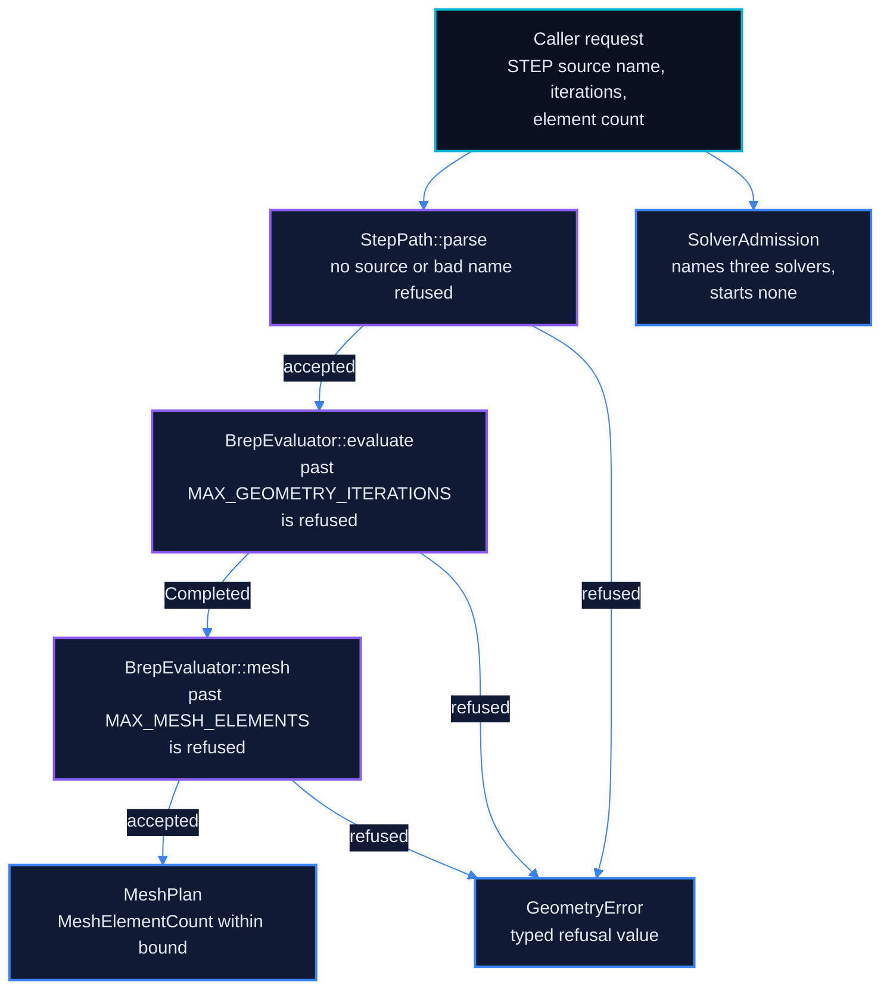

<!--
SPDX-FileCopyrightText: 2026 Lusoris <lusoris@pm.me>
SPDX-License-Identifier: EUPL-1.2
-->
<!-- markdownlint-disable MD013 MD023 MD033 MD036 MD041 -->
<!-- A centred header needs inline HTML, a banner image, indented headings and
     badge lines past 80 columns, so those five rules are off for this file.
     The prose below still wraps at 80. -->
<div align="center">

  

  <!-- badge block: one group, fixed order -->
  <!-- 1 release/version -->
  [-3b82f6?style=for-the-badge&labelColor=111a35)](https://github.com/plurano/tornus/blob/main/Cargo.toml)
  <!-- 2 CI/build -->
  [](https://github.com/plurano/tornus/actions/workflows/ci.yml)
  [](https://github.com/plurano/tornus/actions/workflows/reuse.yml)
  [](https://github.com/plurano/tornus/actions/workflows/pages.yml)
  <!-- 4 standards -->
  [](AGENTS.md)
  [](CONTRIBUTING.md)
  [](CONTRIBUTING.md)
  <!-- 5 licence -->
  [](#licence)
  <!-- 6 support -->
  [](https://github.com/sponsors/lusoris)
  [](https://ko-fi.com/lusoris)

  **Geometric modelling kernel for CAD, written in Rust**

  *Its goal: a correct modelling core, checked against a public conformance corpus*

</div>

Tornus is a geometric modelling kernel for CAD, written in Rust. Its goal is a
correct modelling core, checked against a public conformance corpus; neither
the core nor the corpus exists yet. What exists is the crate
`tornus-geometry`: the bounded geometry and meshing limits and the solver
slice of the Aegis OS crate `aegis-hephaestus` have moved here, and Aegis OS
depends on this library instead.

**[Documentation](https://plurano.github.io/tornus/)** · [Documentation source](docs/)

## Name

*Tornus* is Latin for a lathe, the turner's wheel (from Greek *tornos*); a lathe
shapes a solid by turning it. It is pronounced TOR-noos.

## Why Tornus

- Every length is an integer count of micrometres, so a boundary test is not a
  test on float rounding.
- Both bounds (`MAX_GEOMETRY_ITERATIONS`, `MAX_MESH_ELEMENTS`) are held against
  caller input: the 500,000th mesh element is accepted and the 500,001st is
  refused.
- Each refusal is a typed value.
- No function recurses, and every loop carries a scalar upper bound
  (`MAX_GEOMETRY_ITERATIONS`, `MAX_STEP_PATH_LEN`).
- Every value on a decision path is `Copy`, so no such path allocates
  (`tests/allocation_bounds.rs`).
- There is no `unwrap`, `expect`, `panic!`, slice indexing, unchecked
  arithmetic or `unsafe`.

## Get started

The crate is not on crates.io yet; a consumer depends on it by Git.

```toml
[dependencies]
tornus-geometry = { git = "https://github.com/plurano/tornus" }
```

### First use

```rust
use tornus_geometry::{
    BrepEvaluator, CadEngine, EvaluationOutcome, MAX_MESH_ELEMENTS, MeshConfig, StepPath,
    Tolerance,
};

let evaluator = BrepEvaluator::new(CadEngine::ExactNurbsBrep, Tolerance::SCAFFOLD);
let source = StepPath::parse("/var/lib/geometry/bracket.step")?;

let walked = evaluator.evaluate(Some(source), 120)?;
assert_eq!(walked, EvaluationOutcome::Completed { iterations: 120 });
assert!(evaluator.evaluate(None, 120).is_err());

let config = MeshConfig::new(100, 2_000, true)?;
let plan = evaluator.mesh(config, 120_000)?;
assert_eq!(plan.elements.get(), 120_000);
assert!(evaluator.mesh(config, MAX_MESH_ELEMENTS).is_ok());
assert!(evaluator.mesh(config, MAX_MESH_ELEMENTS + 1).is_err());
```

## At a glance



| Type | Role |
| :--- | :--- |
| `BrepEvaluator` | Holds `MAX_GEOMETRY_ITERATIONS` and `MAX_MESH_ELEMENTS` against caller input, and refuses a request with no STEP source before either. |
| `MeshElementCount` | Carries the meshing bound as a value, so an element count on a consumer's wire holds the same bound as the planner. |
| `SolverAdmission` | Names three solvers and starts none; the crate has no dispatch method. |

## Guides and reference

- [Documentation site](https://plurano.github.io/tornus/)
- [The geometry crate](https://plurano.github.io/tornus/geometry/): holds the
  bounded geometry and meshing limits and solver admissions, and links no CAD
  kernel, mesher or solver.
- [Decision records](docs/adr/README.md)
- [Contributing](CONTRIBUTING.md)
- [Security policy](SECURITY.md)

## Contribute

Read [CONTRIBUTING.md](CONTRIBUTING.md) before opening a pull request. Commits
follow Conventional Commits and are signed off.

```sh
cargo build --locked
cargo test --locked
```

## Support

Questions, ideas and defects go to
[issues](https://github.com/plurano/tornus/issues), and security reports to
a [private advisory](https://github.com/plurano/tornus/security/advisories/new),
as [SECURITY.md](SECURITY.md) asks.

The maintainer's work on the Plurano libraries can be sponsored on
[GitHub Sponsors](https://github.com/sponsors/lusoris),
[Ko-fi](https://ko-fi.com/lusoris) or
[Patreon](https://www.patreon.com/Lusoris), any amount; sponsors are thanked,
and no support or priority is sold.

## Status

The workspace is at version 0.1.0 and has no release yet. It holds one crate,
`tornus-geometry`, which is not published to crates.io. The crate holds the
limits and admissions only: it links no CAD kernel, no mesher and no solver,
and opens no file.

## Licence

Licensed under the European Union Public Licence 1.2
([LICENSES/EUPL-1.2.txt](LICENSES/EUPL-1.2.txt)). The repository follows the
[REUSE](https://reuse.software) specification.

## Standards and governance

This repository follows the High-Integrity Systems Standards (HISS-21) and the
NASA/JPL Power of 10 rules; see [AGENTS.md](AGENTS.md) and
[CONTRIBUTING.md](CONTRIBUTING.md).

<!-- praetor:readme-governance:start -->
Praetor manages this repository's declared governance policy. This managed
block records adoption state; it is not a verification certificate.

**Verification**: `make verify-all` runs the repository's configured
verification cascade.

**HISS Audit**: `praetorctl audit` enforces policy, generated-surface
integrity, and the debt ratchet.

**Context Sync**: `praetorctl compile-context --verify` verifies every
generated agent context against `AGENTS.md`.

**Debt Baseline**: `.standards-baseline.json` anchors the debt ratchet at
0 recorded infractions; audit forbids growth.
<!-- praetor:readme-governance:end -->
