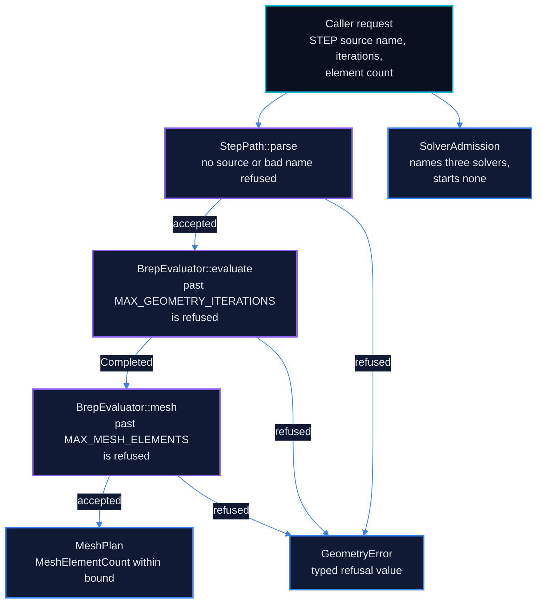

<!--
SPDX-FileCopyrightText: 2026 Lusoris <lusoris@pm.me>
SPDX-License-Identifier: EUPL-1.2
-->

# Tornus

Tornus is a geometric modelling kernel for CAD, written in Rust. Its goal is a
correct modelling core, checked against a public conformance corpus; neither
the core nor the corpus exists yet. What exists is the crate
`tornus-geometry`: the bounded geometry and meshing limits and the solver
slice of the Aegis OS crate `aegis-hephaestus` have moved here, and Aegis OS
depends on this library instead.

## Name

*Tornus* is Latin for a lathe, the turner's wheel (from Greek *tornos*); a lathe
shapes a solid by turning it. It is pronounced TOR-noos.

## Why Tornus

- Every length is an integer count of micrometres, so a boundary test is not a
  test on float rounding.
- Both bounds (`MAX_GEOMETRY_ITERATIONS`, `MAX_MESH_ELEMENTS`) are held against
  caller input: the 500,000th mesh element is accepted and the 500,001st is
  refused.
- Each refusal is a typed value.
- No function recurses, and every loop carries a scalar upper bound
  (`MAX_GEOMETRY_ITERATIONS`, `MAX_STEP_PATH_LEN`).
- Every value on a decision path is `Copy`, so no such path allocates
  (`tests/allocation_bounds.rs`).
- There is no `unwrap`, `expect`, `panic!`, slice indexing, unchecked
  arithmetic or `unsafe`.

## At a glance

| Type | Role |
| :--- | :--- |
| `BrepEvaluator` | Holds `MAX_GEOMETRY_ITERATIONS` and `MAX_MESH_ELEMENTS` against caller input, and refuses a request with no STEP source before either. |
| `MeshElementCount` | Carries the meshing bound as a value, so an element count on a consumer's wire holds the same bound as the planner. |
| `SolverAdmission` | Names three solvers and starts none; the crate has no dispatch method. |

## Status

The workspace is at version 0.1.0 and has no release yet. It holds one crate,
`tornus-geometry`, which is not published to crates.io. The crate holds the
limits and admissions only: it links no CAD kernel, no mesher and no solver,
and opens no file.

## Pages

- [The geometry crate](geometry.md)
- [Decision records](adr/README.md)

Install steps are in the
[repository README](https://github.com/plurano/tornus#get-started).
